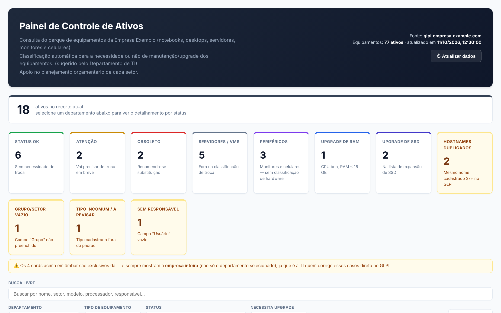
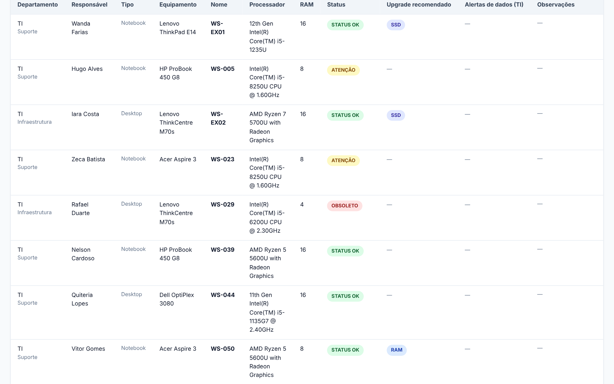
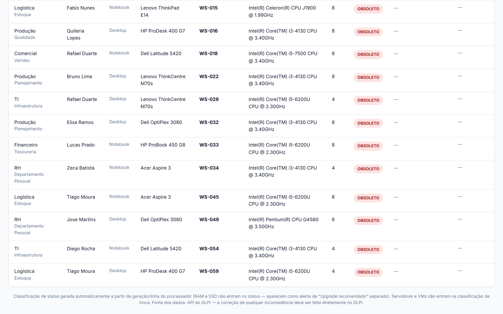

# glpi-asset-dashboard

[Português](README.md) · [English](README.en.md) · **Español (Honduras)**

Un panel web amigable para el control de activos de TI, construido sobre [GLPI](https://glpi-project.org/), más una GPO que mantiene el GLPI Agent instalado y el inventario siempre actualizado.

GLPI guarda todo, pero no es la herramienta más práctica para un jefe de departamento que solo quiere saber "¿qué equipos de mi área necesitan reemplazo o mejora este año?". Este proyecto responde esa pregunta con una página de consulta sencilla, alimentada en vivo por el propio GLPI.

> **Aviso: datos ficticios.** Todos los nombres, dominios, direcciones IP y hostnames de este repositorio (`empresa.example.com`, `empresa.local`, `10.0.0.x`, `203.0.113.x`, `WS-EX01`…) son ejemplos inventados. Nada de lo que aparece aquí proviene de un ambiente real. Vea la [sección final](#aviso-datos-ficticios).

## El problema

- Los jefes necesitan planificar el presupuesto de mantenimiento, mejora y reemplazo de equipos, pero la interfaz de GLPI está pensada para el equipo de TI.
- Exportar CSV desde GLPI y armar hojas de cálculo a mano se desactualiza rápido y genera retrabajo.
- Un inventario solo es confiable si los agentes están instalados y reportando al día. Una instalación mal hecha por GPO (por ejemplo, reinstalando en cada arranque) produce inventario duplicado y datos viejos.

## Qué entrega el proyecto

**1. Panel de activos (`painel/`)**

- Una sola página (HTML, CSS y JS, sin dependencias externas) que consulta GLPI mediante una capa PHP. Los tokens de la API quedan solo en el servidor, nunca en el navegador.
- Cubre los itemtypes **Computer**, **Monitor** y **Phone**.
- Clasifica cada equipo de usuario según su CPU: **OK**, **Atención** u **Obsoleto**.
- Genera alertas de **mejora de RAM** y de **SSD**.
- Tiene categoría propia para **servidores/VM** y para **periféricos** (sin clasificación de hardware).
- Incluye **indicadores de calidad de datos** para TI: hostnames duplicados, grupo/departamento vacío, tipo inusual y equipo sin responsable.
- Ofrece búsqueda libre, filtros por departamento, tipo, estado y mejora, tarjetas con clic y ordenamiento por columna.
- Agrupa el monitor o el celular bajo la computadora del mismo responsable.

**2. Automatización del GLPI Agent por GPO (`gpo/`)**

- Instala o actualiza el agente **sin bajar de versión** y sin reinstalar cuando la versión ya está al día.
- Garantiza que el servicio esté activo y corrige el valor `server` en el registro.
- Crea una tarea programada local que **fuerza el inventario** en el arranque y al iniciar sesión, con un intervalo mínimo de 2 horas.
- Activa el ícono de la bandeja del agente (vea la [documentación de la GPO](docs/gpo-glpi-agent.md) para saber por qué esto requiere cuidado).

## Capturas de pantalla

> Datos ficticios: los hostnames, nombres y dominios son inventados.







## Arquitectura a alto nivel

```
Navegador ──► Proxy inverso (TLS) ──► Nginx ──► PHP-FPM ──► API REST de GLPI
                                         │          │
                                         │          └─ api_ativos.php + glpi_client.php
                                         │             (aquí viven los tokens, con caché en archivo)
                                         └─ painel_ativos.html (estático)

Estaciones Windows ──► GPO (Inicio) ──► Install-GLPIAgent.ps1
                                         └─ tarea programada ──► Invoke-GLPIInventory.ps1
                                                                  └─ http://127.0.0.1:62354/now ──► agente ──► GLPI
```

El proxy inverso es opcional: sirve para tener un certificado válido y para restringir el acceso a redes privadas. La decisión de diseño fue mantener el panel **sin inicio de sesión**, solo para uso interno o por VPN. Los detalles están en [`docs/painel-documentacao.md`](docs/painel-documentacao.md) (en portugués).

## Requisitos previos

**Panel**

- GLPI 10.x con la **API REST** habilitada.
- Un **cliente de API** en GLPI (genera el `App-Token`) y un **usuario de servicio de solo lectura** (genera el `User-Token`).
- Un servidor web con **PHP** (con la extensión `curl`) y HTTPS. Los ejemplos usan Nginx + PHP-FPM.
- Acceso de red desde el servidor del panel hacia la API de GLPI.

**GPO del agente**

- Active Directory con una GPO de Inicio (Configuración del equipo).
- Una carpeta compartida en red que las estaciones puedan leer (los ejemplos usan `NETLOGON`).
- El instalador MSI del [GLPI Agent](https://github.com/glpi-project/glpi-agent/releases) (este repositorio **no** incluye el `.msi`).

## Implementación

### 1. Panel

1. Cree un directorio **separado** de la instalación de GLPI, por ejemplo `/var/www/painel-ativos/`, y copie allí el contenido de `painel/`. No coloque el panel dentro de la carpeta de GLPI ni edite el vhost de GLPI.
2. Copie `config.example.php` a `config.php` y complete `glpi_url`, `app_token` y `user_token`. **Nunca versione el `config.php` ya completado.**
3. Ajuste el dueño y los permisos (ejemplo con Nginx y PHP-FPM corriendo como `apache`):

   ```bash
   chown -R apache:nginx /var/www/painel-ativos
   chmod 640 /var/www/painel-ativos/config.php
   chown apache:apache /var/www/painel-ativos/cache && chmod 770 /var/www/painel-ativos/cache
   ```

   Si copia un archivo como root después del `chown`, vuelve a quedar como `root:root`. Vuelva a aplicar `chown`/`chmod` después de cada envío.
4. Valide la sintaxis de PHP: `for f in config.php glpi_client.php api_ativos.php common.php; do php -l "$f"; done`.
5. Cree un vhost propio, en un archivo nuevo (por ejemplo `/etc/nginx/conf.d/ativos.conf`). Este es el vhost usado en el proyecto, anonimizado; comparte el puerto 443 con GLPI y reutiliza el certificado Let's Encrypt (ajuste las rutas a su certbot o a su certificado):

   ```nginx
   server {
       listen 443 ssl;
       server_name ativos.empresa.example.com;

       root /var/www/painel-ativos;
       index painel_ativos.html;

       ssl_certificate     /etc/letsencrypt/live/glpi.empresa.example.com/fullchain.pem;
       ssl_certificate_key /etc/letsencrypt/live/glpi.empresa.example.com/privkey.pem;
       include /etc/letsencrypt/options-ssl-nginx.conf;
       ssl_dhparam /etc/letsencrypt/ssl-dhparams.pem;

       # Nunca servir la configuración ni el código interno, ni el caché.
       location ~* /(config\.example\.php|config\.php|common\.php|glpi_client\.php)$ {
           deny all;
           return 404;
       }
       location ~ ^/cache/ {
           deny all;
           return 404;
       }

       location ~ \.php$ {
           fastcgi_pass unix:/run/php-fpm/www.sock;
           fastcgi_split_path_info ^(.+\.php)(/.+)$;
           try_files $fastcgi_script_name =404;
           set $path_info $fastcgi_path_info;
           fastcgi_param PATH_INFO $path_info;
           fastcgi_param SCRIPT_FILENAME $document_root$fastcgi_script_name;
           include fastcgi_params;
           fastcgi_index index.php;
       }

       location / {
           try_files $uri $uri/ =404;
       }
   }
   ```

   Nginx elige el vhost por nombre (`server_name`), así que varios sitios comparten el puerto 443 sin conflicto y **sin editar** el vhost de GLPI. La ruta del socket de PHP-FPM (`/run/php-fpm/www.sock`) cambia según la distribución.
6. Ejecute `nginx -t` y solo entonces `systemctl reload nginx` (evite `restart`).
7. Edite la lista `SSD_EXPANSION_LIST` en `painel_ativos.html` con los hostnames que correspondan a su ambiente.

### 2. GPO del agente

1. Coloque en la carpeta compartida (por ejemplo `\\empresa.local\netlogon\scripts\GLPI\`): el MSI del agente, `Install-GLPIAgent.ps1`, `Invoke-GLPIInventory.ps1` e `install-glpi.bat`.
2. En `Install-GLPIAgent.ps1`, ajuste el bloque de parámetros: `$TargetVersion`, `$SetupLocation` y `$GlpiServerUrl`. El nombre del MSI debe coincidir con `GLPI-Agent-<versión>-x64.msi`.
3. Cree una GPO con un **Script de Inicio** (Configuración del equipo) que apunte a `install-glpi.bat`, y vincúlela a las OU de equipos.
4. En GLPI, reduzca el intervalo de inventario del servidor (el proyecto usó 12 h) como red de seguridad por si el script local falla.
5. Los scripts corren como `SYSTEM` y escriben un registro en `C:\ProgramData\GLPI-Agent-Deploy\install-glpi-agent.log`.

## Cómo validar

**Panel**

- Abra `api_ativos.php?debug=1`. Lo esperado es `campos_faltando: []` (sin campos faltantes) para Computer, Monitor y Phone.
- Use `api_ativos.php?nocache=1` para ignorar el caché y consultar GLPI de nuevo.
- Abra el panel en el navegador y verifique el total de activos en el encabezado y una muestra de registros contra GLPI.

**GPO**

- Revise el registro en `C:\ProgramData\GLPI-Agent-Deploy\install-glpi-agent.log` en una estación.
- `Get-ScheduledTask -TaskName 'GLPI-Agent - Forcar Inventario'` debe mostrar la tarea creada; un `LastTaskResult` igual a `0` indica éxito.
- La versión instalada está en `HKLM:\SOFTWARE\GLPI-Agent\Installer` (`Version`).
- Para forzar un inventario manualmente, abra `http://127.0.0.1:62354/now` en la propia estación.

## Problemas comunes

| Síntoma | Causa probable | Qué hacer |
| --- | --- | --- |
| HTTP 500 al abrir la API | PHP-FPM no puede leer `config.php` (archivo copiado como root) | `chown apache:nginx config.php && chmod 640 config.php` |
| Error de sintaxis en `config.php` | Tokens pegados sin comillas simples | Ponga comillas simples alrededor de cada token y ejecute `php -l config.php` |
| `campos_faltando` no está vacío | GLPI usa uids compuestos (`Computer.<Tipo>.<campo>`) que varían entre instalaciones | Abra `?debug=1&itemtype=Computer`, localice el uid real y ajuste `candidatos_de_campo()` en `glpi_client.php` |
| Ningún activo aparece como "necesita RAM" | GLPI guarda la memoria en **MB** y la regla espera GB | Ya está resuelto en `glpi_client.php` (división entre 1024); si lo modifica, valide con `?nocache=1` |
| Datos desactualizados | Caché de 15 minutos | Use el botón "Atualizar dados" (actualizar datos) o `?nocache=1` |
| Advertencia de certificado | El certificado cubre un nombre distinto al del vhost | Emita un certificado para el nombre del panel (por ejemplo, mediante un proxy inverso) |
| Las pruebas con `curl` en el propio servidor de GLPI no resuelven el nombre del panel | El servidor usa DNS público, sin los registros internos | Use `curl --resolve <nombre>:443:<ip>` |
| El ícono de la bandeja del agente "desapareció" justo después de instalar | El inicio automático solo se dispara en una **sesión nueva** | Cierre sesión y vuelva a entrar antes de investigar |
| Error 1625 de `msiexec` después de un reinicio | Condición transitoria del Windows Installer | Reinicie de nuevo antes de investigar más |
| No se pueden sobrescribir los scripts en la carpeta compartida | Solo los administradores del servidor de archivos tienen escritura | Use una cuenta con derechos de administrador en ese servidor |

## Seguridad

- El panel **no tiene autenticación** (decisión de diseño). Expóngalo solo en la red interna o por VPN, y/o restrinja el acceso por IP en el proxy.
- El endpoint `api_ativos.php?debug=1` muestra la estructura de campos de GLPI y tampoco está autenticado. Restrinja su acceso o elimínelo en producción.
- Mantenga `config.php` y `cache/` fuera del alcance del navegador (vea el vhost de ejemplo) y **nunca** los versione.
- Use un usuario de servicio de **solo lectura** y, si es posible, restrinja el cliente de API por IP.

## Documentación y hoja de ruta

- [`docs/painel-documentacao.md`](docs/painel-documentacao.md): arquitectura, reglas de negocio y cómo actualizar el panel.
- [`docs/gpo-glpi-agent.md`](docs/gpo-glpi-agent.md): diagnóstico, diseño y pruebas de la GPO.
- [`docs/historico-painel.md`](docs/historico-painel.md): historial de decisiones y errores encontrados durante la implementación.
- [`ROADMAP.es-HN.md`](ROADMAP.es-HN.md): mejoras futuras.

La carpeta `docs/` está disponible solo en portugués.

## Aviso: datos ficticios

Este repositorio se derivó de un proyecto real de infraestructura y **fue anonimizado antes de su publicación**. Todos los nombres de empresa, dominios, direcciones IP, hostnames, cuentas y personas que aparecen aquí son **ficticios** y sirven solo como ejemplo:

- Dominios: `empresa.example.com` (público) y `empresa.local` (interno).
- Redes: `10.0.0.x` (interna) y `203.0.113.x` (rango reservado para documentación).
- Equipos: `WS-EX01`, `srv-ad01`, `srv-proxy01`, etc.

Los valores de `config.example.php` son solo marcadores. Reemplace todo por los de su ambiente.

## Licencia

[GNU GPL v3.0](LICENSE).

Mantenido por [@manueljpv](https://github.com/manueljpv).
